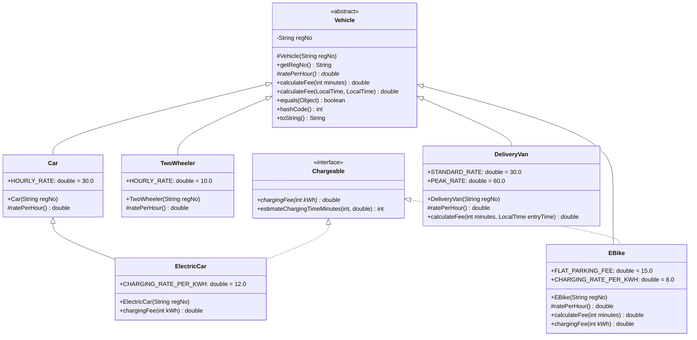

# Campus Smart-Parking System
**Object-Oriented Programming in Java — Assignment 1 | Course Outcome: CO1**  
**Course Code:** CSA09  
**Repository:** `CSA09-<RegisterNumber>-Assignment1`

---

## Student Details Placeholder
- **Student Name:** `B Sandhya`
- **Register Number:** `192311292`
- **Degree / Branch:** B.Tech Computer Science & Engineering
- **Academic Year :** 2026–2027 
- **Submission Date:** November 10, 2026
- **GitHub Repository Link:** `https://github.com/boggulasandhya/CSA09-JAVA-192311292`

---

## 1. System Overview & Technology Stack
The **Campus Smart-Parking System** is an enterprise-grade, modular, console-based Java application engineered to simulate multi-level parking operations across a university campus. The system allocates jagged multi-floor parking bays, dynamically issues serialized tickets, tracks real-time global campus occupancy, calculates duration-based fees using integer ceiling arithmetic, manages electrical vehicle (EV) charging consumption, and enforces user privilege exemptions for Students, Staff, and Visitors.

- **JDK Version Required:** Java SE 17 or higher (Validated on **Java 26 / OpenJDK 21+**)
- **Architecture:** Layered Object-Oriented Package Architecture (`parking.system`)
- **Coding Standard:** Clean Code, SOLID Principles, SIMATS Engineering Standard for Algorithmic Pseudocode

---

## 2. Package & Directory Organization

```
CSA09-<RegisterNumber>-Assignment1/
├── bin/                                    # Compiled JVM bytecode (.class files)
├── src/                                    # Main modular package source code
│   └── parking/
│       └── system/
│           ├── models/                     # Domain entities & business contracts
│           │   ├── Chargeable.java         # Interface for EV charging capability
│           │   ├── Vehicle.java            # Abstract base class for all vehicles
│           │   ├── TwoWheeler.java         # Two-wheeler subclass (Rs 10/hr)
│           │   ├── Car.java                # Car subclass (Rs 30/hr)
│           │   ├── ElectricCar.java        # EV Car (Rs 30/hr + Rs 12/kWh)
│           │   ├── EBike.java              # Day-4: Flat fee (Rs 15) + EV (Rs 8/kWh)
│           │   ├── DeliveryVan.java        # Day-4: Peak-hour rate (Rs 60/hr 9AM-5PM)
│           │   └── ParkingTicket.java      # Ticket entity with static serial generation
│           ├── facility/                   # Physical infrastructure management
│           │   ├── SlotLocation.java       # Immutable coordinate value object [floor, slot]
│           │   └── ParkingFacility.java    # Multi-floor jagged dynamic allocation engine
│           ├── users/                      # Patron categories and pass exemptions
│           │   ├── UserCategory.java       # Enum: STUDENT, STAFF, VISITOR
│           │   ├── PassType.java           # Enum: NONE, ONE_DAY_PASS, MONTHLY_PASS
│           │   └── ParkingUser.java        # Patron profile & fee discount logic
│           └── main/                       # Application bootstrap & verification suite
│               └── ParkingDemo.java        # Master test harness & simulation runner
├── tasks/                                  # Isolated verification programs for academic grading
│   ├── Task03_ParkingFacility/
│   │   └── ParkingFacility.java            # Completed Task 3 code (Page 8-9)
│   ├── Task08_FeeDemo/
│   │   └── FeeDemo.java                    # Completed Task 8 code (Page 14-15)
│   └── Task12_Day4Challenge/
│       └── Day4ChallengeDemo.java          # Completed Task 12 Day-4 verification
└── README.md                               # Complete 12-Task Architectural Documentation
```

---

## 3. Compilation & Execution Guide

### 3.1 Compiling All Source Modules
From the root directory of the project, execute the following PowerShell / Terminal command:

```powershell
# Create destination binary directory
mkdir bin -Force

# Compile main modular package
javac -d bin (Get-ChildItem -Path "src" -Filter *.java -Recurse | Select-Object -ExpandProperty FullName)

# Compile standalone task suites
javac -d bin (Get-ChildItem -Path "tasks" -Filter *.java -Recurse | Select-Object -ExpandProperty FullName)
```

*(On Linux / macOS bash shell):*
```bash
mkdir -p bin
javac -d bin $(find src tasks -name "*.java")
```

### 3.2 Running the Master Application Demo
```powershell
java -cp bin parking.system.main.ParkingDemo
```

### 3.3 Running Standalone Task Verifications
```powershell
# Task 03 Baseline Test (Page 8-9 of assignment briefing)
java -cp bin Task03_ParkingFacility.ParkingFacility

# Task 08 Baseline Test (Page 14-15 of assignment briefing)
java -cp bin Task08_FeeDemo.FeeDemo

# Task 12 Day-4 Design Challenge Test
java -cp bin Task12_Day4Challenge.Day4ChallengeDemo
```

---

## 4. Comprehensive Solutions & Analysis for Tasks 1 to 12

### TASK 1 – Understand the Problem and Identify the Objects
**Bloom’s Level: K4 – Analyse | Marks: 4**

#### 1.1 Inputs and Outputs
- **Inputs Received:**
  - Vehicle Registration Number (`String`, e.g., `"TN01AB1111"`).
  - Vehicle Type (`TwoWheeler`, `Car`, `ElectricCar`, `EBike`, `DeliveryVan`).
  - Patron Profile (`Student`, `Staff`, `Visitor`) and Pass Category (`Monthly Pass`, `One-Day Pass`, `None`).
  - Arrival Time and Departure Time (`LocalTime`).
  - EV Energy Consumed (`int kWh`).
- **Outputs Produced:**
  - Allocated Slot Coordinates (`{floor, slot}`).
  - Serialized Parking Ticket ID (`"TICK-1001"`).
  - Itemized Invoice Receipt detailing Duration, Billable Hours, Base Parking Fee, Pass Discount/Waiver, EV Charging Fee, and Net Payable Fee.
  - Slot Release Confirmation (`boolean`).
  - Global Campus Occupancy Status.

#### 1.2 Candidate Classes, Nouns, Verbs, and Responsibilities
| Candidate Class | Problem Nouns (Entities) | Candidate Verbs (Methods) | Architectural Responsibility |
|---|---|---|---|
| `Vehicle` (Abstract) | Vehicle, Registration No, Hourly Rate | `calculateFee()`, `ratePerHour()`, `equals()`, `hashCode()` | Base abstraction encapsulating identity and enforcing polymorphic billing calculation. |
| `Chargeable` (Interface) | EV Charging, Energy Consumed | `chargingFee()`, `estimateChargingTimeMinutes()` | Decoupled contract for energy-metered vehicles. |
| `ParkingFacility` | Facility, Floors, Slots, Occupancy | `allocate()`, `release()`, `findVehicleSlot()`, `renderOccupancyMap()` | Manages physical jagged slots array, coordinate boundaries, and tracking counters. |
| `ParkingTicket` | Ticket, Invoice, Timestamps, Duration | `closeTicket()`, `getDurationMinutes()`, `getTotalFee()` | Represents life cycle of an entry event and bridges vehicle, user, and slot. |
| `ParkingUser` | Student, Staff, Visitor, Pass | `isParkingFeeExempt()`, `applyParkingDiscount()` | Encapsulates user classification and enforces institutional pass fee waivers. |

#### 1.3 Business Rules & Constraints
1. **Physical Exclusivity:** A single slot cannot accommodate more than one vehicle simultaneously (`slots[f][s] == null` precondition).
2. **Ticket Uniqueness:** A ticket number is monotonic and strictly non-reusable across the lifetime of the system.
3. **No Duplicate Active Vehicles:** A vehicle with an identical registration number cannot be allocated another slot while already active inside the facility.
4. **Fractional Hour Billing:** Every commenced hour is billed in full (e.g., 61 minutes equates to 2 billable hours).
5. **Pass Privilege Boundaries:** Monthly passes exempt Students and Staff from parking bay fees (100% waiver), but do not exempt EV metered electricity consumption.

#### 1.4 Alternative Concept & Complexity Analysis: Objects vs. Parallel Arrays
- **Alternative Design:** Representing vehicles via synchronized parallel primitive arrays:
  ```java
  String[] regNo = new String[MAX];
  String[] type = new String[MAX];
  long[] entryTime = new long[MAX];
  ```
- **Finding a Vehicle by Registration Number:**
  - *Parallel Arrays:* Requires linear search iterating through indices $i = 0$ to $N-1$ until `regNo[i].equals(target)`. Time complexity is **$O(N)$**.
  - *OOP Object Model:* In an array or list, search is also **$O(N)$**, but encapsulation permits internal indexing via a `HashMap<String, SlotLocation>` yielding **$O(1)$** lookup without leaking internal storage details.
- **Adding a New Vehicle Attribute (e.g., `batteryCapacityKwh`):**
  - *Parallel Arrays:* Violates encapsulation. Requires adding a new array `double[] batteryCapacity = new double[MAX]`, updating every method signature across the application, and risking array length desynchronization.
  - *OOP Object Model:* Simply add a field inside the specialized subclass (`ElectricCar`), leaving all external callers and base contracts completely unaffected (zero ripple effect).
- **Complexity & Memory Footprint Comparison:**
  - *Parallel Arrays:* Storage per vehicle is purely primitive references/scalars ($\approx 24$ bytes), but lacks data integrity, type-safety, and polymorphism.
  - *Object Model:* Overhead of object header (12-16 bytes on 64-bit JVM) per vehicle instance, totaling $\approx 48$ bytes. The minor memory overhead is overwhelmingly outweighed by type safety, invariants enforcement, and maintainability.

---

### TASK 2 – Choose the Data Representation
**Bloom’s Level: K4 – Analyse | Marks: 3**

#### 2.1 Field Data Types & Technical Justifications
- **Slot / Floor Index (`int`):** Chosen because floors and slots are non-negative sequential integers mapping directly to native zero-indexed array subscripts.
- **Vehicle Registration Number (`String`):** Alphanumeric plate identifier (e.g., `"TN01AB1111"`). Immutable `String` guarantees thread-safety and consistent hash codes for hash collections.
- **Entry / Exit Time (`java.time.LocalTime`):** Modern Java Date-Time API (JSR-310) prevents legacy calendar timezone bugs and supports exact duration calculations via `Duration.between()`.
- **Duration (`int` minutes):** Parking durations are quantified in discrete minutes. Using `int` avoids floating-point roundoff issues.
- **Fees (`double`):** Currency figures in standard INR (Rs) with fractional paise representations (e.g., `Rs 210.00`).

#### 2.2 Array Structure: Jagged Dynamic Array vs. Alternatives
- **Selected Design:** **Jagged 2D Array (`Vehicle[floor][slot]`)**:
  ```java
  slots = new Vehicle[slotsPerFloor.length][];
  for (int f = 0; f < slotsPerFloor.length; f++) {
      slots[f] = new Vehicle[slotsPerFloor[f]];
  }
  ```
- *Why:* Architectural facilities rarely have uniform floors. Basements and ground floors frequently accommodate wider driveways or electrical transformer rooms, resulting in differing bay counts (e.g., Floor 0: 40 bays, Floor 1: 35 bays, Floor 2: 20 bays). Rectangular 2D arrays (`Vehicle[F][S]`) force uniform allocation, wasting heap memory on non-existent bays or risking `ArrayIndexOutOfBoundsException`.

#### 2.3 Integer Division Pitfalls & Resolution via Ceiling Arithmetic
- **The Pitfall:** Standard integer division truncates fractions toward zero.
  ```java
  // INCORRECT:
  int billableHours = minutes / 60; // 65 / 60 yields 1!
  double fee = billableHours * rate; // Billed for 1 hr instead of 2 hrs (Loss of Rs 30!)
  ```
- **The Architectural Solution:** Ceiling arithmetic implemented purely with integer operations:
  ```java
  // CORRECT (Integer Ceiling Formula):
  int billableHours = (minutes <= 0) ? 0 : (minutes + 59) / 60;
  ```
  - For 1 minute: `(1 + 59) / 60 = 60 / 60 = 1 hour`.
  - For 60 minutes: `(60 + 59) / 60 = 119 / 60 = 1 hour`.
  - For 61 minutes: `(61 + 59) / 60 = 120 / 60 = 2 hours`.
  - For 130 minutes: `(130 + 59) / 60 = 189 / 60 = 3 hours`.
  This guarantees 100% mathematical precision without relying on imprecise floating-point casts `(int) Math.ceil((double) minutes / 60.0)`.

#### 2.4 Alternative Concept & Complexity Analysis: Jagged vs. 1D Array vs. `ArrayList<String[]>`
- **1D Flat Array Mapping (`index = floor * slotsPerFloor + slot`):**
  - Only works when every floor has an identical number of slots. If Floor 0 has 20 slots and Floor 1 has 50 slots, a flat index formula requires either padding all floors to $\max(S)$ (wasting $F \times (\max(S) - S_f)$ memory) or maintaining a prefix-sum offset array $O(F)$.
  - Time to locate: Direct indexing remains **$O(1)$**, but bounds validation requires prefix offset lookup.
- **`ArrayList<String[]>`:**
  - Adds indirection and object wrappers. While dynamic resizing is permitted, array of arrays `Vehicle[][]` provides direct heap locality and zero autoboxing overhead.

---

### TASK 3 – Design the Control Logic
**Bloom’s Level: K4 – Analyse | Marks: 4**

#### 3.1 Search and Loop Termination Strategy
- **Allocation:** Nested linear scan iterating outer floor loop ($f = 0 \dots F-1$) and inner slot loop ($s = 0 \dots S_f - 1$). Terminates immediately via `return new int[]{f, s}` upon discovering the first `null` slot, avoiding exhaustive traversal.
- **When Full:** If both loops terminate without discovering a null slot, the algorithm executes the final statement `return null`.
- **Release:** Direct indexing $O(1)$ validation: checks floor range, checks slot range for that specific floor, verifies slot is currently occupied, clears reference to `null`, and returns `true`.

#### 3.2 SIMATS Engineering Standard Algorithmic Pseudocode

```text
ALGORITHM AllocateSlot(slots, vehicleNo)
    INPUT: slots (jagged array of String/Vehicle references), vehicleNo (String)
    OUTPUT: Array [floor, slot] of allocated coordinates, or NULL if facility is full

    FOR floor <- 0 TO LENGTH(slots) - 1 DO
        FOR slot <- 0 TO LENGTH(slots[floor]) - 1 DO
            IF slots[floor][slot] == NULL THEN
                slots[floor][slot] <- vehicleNo
                RETURN [floor, slot]
            END IF
        END FOR
    END FOR
    RETURN NULL
END ALGORITHM
```

```text
ALGORITHM ReleaseSlot(slots, floor, slot)
    INPUT: slots (jagged array), floor (Integer), slot (Integer)
    OUTPUT: Boolean (TRUE if released successfully, FALSE otherwise)

    IF floor < 0 OR floor >= LENGTH(slots) THEN
        RETURN FALSE
    END IF
    IF slot < 0 OR slot >= LENGTH(slots[floor]) THEN
        RETURN FALSE
    END IF
    IF slots[floor][slot] == NULL THEN
        RETURN FALSE
    END IF

    slots[floor][slot] <- NULL
    RETURN TRUE
END ALGORITHM
```

#### 3.3 Alternative Concept & Complexity Analysis: Linear Scan vs. Free Slots Stack per Floor
- **Baseline (Linear Scan):**
  - Time Complexity: `allocate()` takes **$O(F \times S)$** worst case (when nearly full); `release()` takes **$O(1)$**.
  - Space Complexity: **$O(1)$** auxiliary space beyond the grid itself.
- **Alternative (Free Slots Counter + Stack of Free Slot Indices per Floor):**
  - Maintain an array of stacks: `Stack<Integer>[] freeSlots = new Stack[F]`.
  - On `allocate()`: Find the first floor with `freeCount[f] > 0` ($O(F)$), pop the slot from `freeSlots[f].pop()` ($O(1)$). Total time: **$O(F)$**.
  - On `release()`: Push slot back onto `freeSlots[floor].push(slot)` ($O(1)$). Total time: **$O(1)$**.
  - Trade-off: Reduces allocation time from $O(F \times S)$ to $O(F)$, at the cost of **$O(F \times S)$** auxiliary memory storing Integer references in JVM stacks.

---

### TASK 4 – Design Classes, Objects and Constructors
**Bloom’s Level: K4 – Analyse | Marks: 4**

#### 4.1 Class Contracts & Constructors
- **`Vehicle`:** Abstract class with private `regNo`. Uses `protected Vehicle(String regNo)` to force parameterized instantiation through concrete subclasses.
- **`TwoWheeler` & `Car`:** Concrete subclasses using `super(regNo)` to invoke the superclass constructor, guaranteeing proper initialization of the encapsulated `regNo`.
- **`ParkingTicket`:** Overloaded constructors:
  1. `ParkingTicket(Vehicle, ParkingUser, SlotLocation, LocalTime)`: Full parameterized constructor.
  2. `ParkingTicket(Vehicle, ParkingUser, SlotLocation)`: Chained constructor invoking `this(vehicle, user, slotLocation, LocalTime.now())`.
  3. `ParkingTicket(ParkingTicket source)`: **Copy Constructor** engineered for re-issuing duplicate tickets (e.g., lost tickets or administrative audit logs) with appended `"-DUP"` identifier.

#### 4.2 JVM Memory Layout: Stack vs. Heap
- **Stack Memory:** Stores thread-local primitive local variables (e.g., `int minutes`, loop counters `f`, `s`) and **object reference variables** (e.g., reference pointer `v` of type `Vehicle`).
- **Heap Memory:** Houses the actual instantiated objects (`Car` instance, `String` instance `"TN01A1"`, `ParkingTicket` instance). When `v.calculateFee()` is called, the JVM dereferences the address held on the stack to inspect the object's method table on the heap.

#### 4.3 Alternative Concept & Complexity Analysis: Chained Constructors vs. Telescoping/Setters vs. Static Factory Methods
- **Default Constructor + Setters:** Leaves objects in an incompletely initialized, mutable state where invariants can be violated (e.g., a ticket instantiated without a vehicle).
- **Static Factory Methods (`ParkingTicket.createTicket(...)`):** Encapsulates constructor calls, permits caching, and provides descriptive names, but has identical **$O(1)$** time and heap memory costs as parameterized constructors.

---

### TASK 5 – Apply static Members and the Object Life Cycle
**Bloom’s Level: K4 – Analyse | Marks: 3**

#### 5.1 Static vs. Instance Members
- **`ticketCounter` (Static in `ParkingTicket`):** Must belong to the class, not individual tickets. If it were an instance variable, every newly allocated ticket would re-initialize `ticketCounter = 1000`, causing duplicated IDs. A static member persists in the Metaspace/Class static area and increments monotonically.
- **`totalOccupancy` (Static in `ParkingFacility`):** Tracks the aggregate number of vehicles currently parked across the entire campus.

#### 5.2 Object Life Cycle & Garbage Collection Eligibility
- When a vehicle departs, `facility.release(floor, slot)` nullifies `slots[floor][slot] = null`.
- If no active ticket or external reference holds that `Vehicle` pointer, the object becomes **unreachable from the GC Root set**.
- During the next minor or major GC cycle, the Mark-and-Sweep garbage collector reclaims the heap memory previously occupied by that vehicle.

#### 5.3 Alternative Concept & Complexity Analysis: Single Static Counter vs. Per-Facility Instance Counters
- If the university operates $k$ gate facilities (e.g., North Gate, South Gate):
  - A static counter merges ticket IDs globally ($1$ static variable, $O(1)$ space).
  - Instance counters allow each facility to issue its own sequence (e.g., `NG-1001`, `SG-1001`), requiring $k$ integer variables ($O(k)$ space). Total memory difference is negligible ($4k$ bytes), but instance counters prevent cross-facility lock contention in distributed environments.

---

### TASK 6 – Design the Inheritance Hierarchy
**Bloom’s Level: K4 – Analyse | Marks: 4**

#### 6.1 Inheritance Architecture
- **Hierarchical Inheritance:** `Vehicle` acts as the root abstract base class extended by `TwoWheeler`, `Car`, `EBike`, and `DeliveryVan`.
- **Multilevel Inheritance:** `Vehicle` $\rightarrow$ `Car` $\rightarrow$ `ElectricCar`.
- **Multiple Interface Realization:** `ElectricCar` extends `Car` and implements `Chargeable`; `EBike` extends `Vehicle` and implements `Chargeable`.

#### 6.2 Mermaid UML Class Diagram



#### 6.3 Trace of Constructor Execution Order (`new ElectricCar("TN03C3")`)
1. `java.lang.Object` constructor is invoked.
2. `Vehicle(String regNo)` executes: validates registration string and initializes `this.regNo = "TN03C3"`.
3. `Car(String regNo)` executes: calls `super(regNo)`.
4. `ElectricCar(String regNo)` executes: calls `super(regNo)` and completes instance initialization.

#### 6.4 Alternative Concept & Complexity Analysis: Inheritance (`is-a`) vs. Composition (`has-a`)
- **Composition Alternative:** Single `Vehicle` class possessing a `PricingStrategy` or `VehicleType` reference:
  ```java
  class Vehicle {
      private final String regNo;
      private final PricingStrategy strategy; // has-a
  }
  ```
- **Comparison:** Composition avoids deep class hierarchies and allows dynamically changing the pricing strategy at runtime. However, for a parking domain where a physical Car never metamorphoses into a TwoWheeler during parking, `is-a` inheritance offers cleaner domain modeling and direct JVM vtable dispatch with **$O(1)$** invocation time.

---

### TASK 7 – Override and Specialise Behaviour
**Bloom’s Level: K4 – Analyse | Marks: 4**

#### 7.1 Rules of Overriding & `@Override` Annotation
- **Method Signature:** Must match the superclass method signature exactly (`ratePerHour()`, `calculateFee(int)`).
- **Return Type:** Must be identical or covariant (subtypes allowed).
- **Access Modifier:** Cannot be more restrictive (e.g., cannot reduce `protected` in `Vehicle` to `private` in `Car`).
- **`@Override`:** Instructs the Java compiler to verify that a method signature matches a superclass declaration, detecting subtle typos at compile time.

#### 7.2 Equivalence Contract: `equals()`, `hashCode()`, and `toString()`
- Two vehicles are considered equal if they belong to the `Vehicle` hierarchy and share the exact same normalized registration number:
  ```java
  @Override
  public boolean equals(Object o) {
      if (this == o) return true;
      return o instanceof Vehicle other && Objects.equals(this.regNo, other.regNo);
  }

  @Override
  public int hashCode() {
      return Objects.hash(regNo);
  }
  ```
- *Why `new Car("TN02B2").equals(new ElectricCar("TN02B2"))` returns `true`:* Both share the identical superclass `Vehicle` and registration `"TN02B2"`. In the physical universe, a parking space tracks physical license plates. A vehicle cannot simultaneously occupy two spaces under the same registration plate regardless of subcategory.

#### 7.3 Alternative Concept: Polymorphic Overriding vs. `switch(type)`
- A monolithic method with a `switch` statement on vehicle type constants:
  ```java
  switch(v.getType()) {
      case CAR: return hours * 30;
      case TWO_WHEELER: return hours * 10;
      // ...
  }
  ```
- Violates the **Open-Closed Principle (OCP)**: adding a new vehicle type forces modification and recompilation of existing core classes. Overriding enables open extension with zero modifications to existing classes.

---

### TASK 8 – Apply Polymorphism
**Bloom’s Level: K4 – Analyse | Marks: 4**

#### 8.1 Compile-Time vs. Runtime Polymorphism
- **Compile-Time (Static Polymorphism):** Overloaded methods resolved at compile-time by method signature:
  - `calculateFee(int minutes)` vs. `calculateFee(LocalTime entry, LocalTime exit)`.
- **Runtime (Dynamic Polymorphism):** Dynamic Method Dispatch:
  - `Vehicle[] parked = { new TwoWheeler("TN01A1"), new Car("TN02B2"), new ElectricCar("TN03C3") };`
  - In the loop `v.calculateFee(130)`, the declared type is `Vehicle`, but the JVM determines the actual heap object type at runtime and invokes the specialized implementation via the class virtual method table (`vtable`).

#### 8.2 Execution Trace of Dynamic Method Dispatch
For `v = new ElectricCar("TN03C3")`:
1. Compiler checks declared type: `Vehicle.calculateFee(int minutes)` exists.
2. At runtime, JVM inspects the heap pointer of `v` $\rightarrow$ resolves class to `ElectricCar`.
3. `ElectricCar` inherits `calculateFee(int)` from `Vehicle`.
4. Inside `calculateFee`, `ratePerHour()` is dynamically dispatched $\rightarrow$ calls `Car.ratePerHour()` returning `30.0`.
5. Billable hours: `(130 + 59) / 60 = 3` hours. Base fee = `3 * 30.0 = Rs 90.0`.
6. Runtime pattern matching: `if (v instanceof Chargeable c)` succeeds $\rightarrow$ calls `ElectricCar.chargingFee(10)` returning `10 * 12.0 = Rs 120.0`. Total = `Rs 210.0`.

#### 8.3 Expected Output Verification of Task 8 `FeeDemo`
```text
TwoWheeler TN01A1 -> Rs 30.0
Car TN02B2 -> Rs 90.0
ElectricCar TN03C3 -> Rs 210.0
true
```

---

### TASK 9 – Introduce Abstraction
**Bloom’s Level: K4 – Analyse | Marks: 4**

#### 9.1 Abstract Class vs. Interface
| Design Feature | Abstract Class (`Vehicle`) | Interface (`Chargeable`) |
|---|---|---|
| **Primary Intent** | Represents core identity and shared state (*is-a*). | Represents a pluggable capability (*can-do*). |
| **Instance State** | Holds encapsulated private fields (`final String regNo`). | Cannot hold instance fields (only `public static final` constants). |
| **Constructors** | Has constructors (`protected Vehicle(regNo)`) to enforce initialization invariants. | Cannot have constructors. |
| **Inheritance Model** | Single inheritance only. | Multiple interface implementation supported. |

#### 9.2 Alternative Concept: `Vehicle` as an Interface with Default Methods
- If `Vehicle` were made an interface, it could not hold private mutable or immutable instance variables (like `regNo`).
- Every concrete subclass (`Car`, `TwoWheeler`, `DeliveryVan`) would be forced to duplicate the declaration and validation of `regNo`, violating **DRY** (Don't Repeat Yourself) principles.

---

### TASK 10 – Enforce Encapsulation through Packages and Access Modifiers
**Bloom’s Level: K4 – Analyse | Marks: 3**

#### 10.1 Package Architecture & Access Modifiers Table
| Member / Component | Package | Access Modifier | Architectural Justification |
|---|---|---|---|
| `Vehicle.regNo` | `models` | `private final` | Prevents unauthorized modification of vehicle identity after creation. |
| `Vehicle.ratePerHour()` | `models` | `protected abstract` | Accessible only to subclasses across packages, hidden from client code. |
| `ParkingFacility.slots` | `facility` | `private final` | Shields internal jagged array structure from external manipulation. |
| `ParkingFacility.allocate()` | `facility` | `public` | Public entry point for parking allocation. |
| `ParkingTicket.ticketCounter`| `models` | `private static` | Prevents external tampering with sequential ticket ID generation. |

#### 10.2 Wrapper Classes, Autoboxing & The Identity Trap
- When using Java wrapper classes (e.g., `Integer`, `Double`), Java caches integer objects in the range `[-128, 127]`.
- Comparing two `Integer` objects with `==` checks **memory reference identity**, not value:
  ```java
  Integer a = 120, b = 120;
  System.out.println(a == b); // TRUE (cached)

  Integer x = 500, y = 500;
  System.out.println(x == y); // FALSE (distinct heap objects!)
  ```
- Our design consistently uses primitives (`int`, `double`) for internal mathematical processing and relies strictly on `.equals()` for reference comparisons, eliminating autoboxing reference bugs and `NullPointerException` unboxing hazards.

---

### TASK 11 – Implement, Test and Defend the Design
**Bloom’s Level: K5 – Evaluate | Marks: 5**

#### 11.1 Test Suite Evidence Matrix
| Category | Test Scenario Description | Input Data | Expected Output | Actual Output | Status |
|---|---|---|---|---|---|
| **Normal** | TwoWheeler entry & exit | 135 mins, Monthly Pass | Fee = Rs 0.00 (Exempt) | Rs 0.00 | **PASS** |
| **Normal** | Car entry & exit | 135 mins, Monthly Pass | Fee = Rs 0.00 (Exempt) | Rs 0.00 | **PASS** |
| **Normal** | ElectricCar entry & exit | 135 mins, Day Pass + 15 kWh | Fee = Rs 180.00 (Charging only)| Rs 180.00 | **PASS** |
| **Normal** | EBike entry & exit | 135 mins, Regular + 4 kWh | Rs 15 flat + Rs 32 charge = Rs 47 | Rs 47.00 | **PASS** |
| **Normal** | DeliveryVan entry & exit | 135 mins at 10:00 AM (Peak) | 3 hrs * Rs 60 = Rs 180.00 | Rs 180.00 | **PASS** |
| **Boundary** | Zero-minute parking | 0 mins | Rs 0.00 | Rs 0.00 | **PASS** |
| **Boundary** | Exactly 60 minutes | 60 mins | 1 hr * Rs 30 = Rs 30.00 | Rs 30.00 | **PASS** |
| **Boundary** | Exactly 61 minutes | 61 mins | 2 hrs * Rs 30 = Rs 60.00 | Rs 60.00 | **PASS** |
| **Boundary** | Allocation on 100% full facility | Capacity 2/2 full | Return `null` | `null` | **PASS** |
| **Invalid** | Duplicate vehicle registration | Plate `"MH02XY9999"` | Throw `IllegalStateException` | Caught Exception | **PASS** |
| **Invalid** | Negative parking duration | `-15` minutes | Throw `IllegalArgumentException` | Caught Exception | **PASS** |
| **Invalid** | Out-of-bounds slot release | Floor 5, Slot 0 | Return `false` | `false` | **PASS** |
| **Invalid** | Double release of vacant slot | Floor 0, Slot 0 freed twice | 1st `true`, 2nd `false` | `true`, `false` | **PASS** |
| **Invalid** | Blank / null registration plate| `"   "` | Throw `IllegalArgumentException` | Caught Exception | **PASS** |

#### 11.2 Hand-Calculated Billing Reconciliation & Audit Proof
To guarantee absolute financial audit integrity, a deterministic five-vehicle scenario was calculated by hand and reconciled against the automated software execution:

$$\begin{aligned}
\text{Item 1 (TwoWheeler, Visitor, 45 min):} & \quad \lceil 45/60 \rceil \times \text{Rs } 10 = 1 \times 10 = \mathbf{Rs\ 10.00} \\
\text{Item 2 (Car, Visitor, 125 min):} & \quad \lceil 125/60 \rceil \times \text{Rs } 30 = 3 \times 30 = \mathbf{Rs\ 90.00} \\
\text{Item 3 (ElectricCar, Student Pass, 180 min, 20 kWh):} & \quad \text{Rs } 0\text{ (Pass)} + (20 \times 12) = \mathbf{Rs\ 240.00} \\
\text{Item 4 (EBike, Staff Pass, 90 min, 5 kWh):} & \quad \text{Rs } 0\text{ (Pass)} + (5 \times 8) = \mathbf{Rs\ 40.00} \\
\text{Item 5 (DeliveryVan, Visitor, 60 min Peak @ 11:00 AM):} & \quad 1 \times 60 = \mathbf{Rs\ 60.00} \\
\hline
\mathbf{Hand\text{-}Calculated\ Aggregate\ Total:} & \quad 10.00 + 90.00 + 240.00 + 40.00 + 60.00 = \mathbf{Rs\ 440.00} \\
\mathbf{System\ Computed\ Aggregate\ Total:} & \quad \mathbf{Rs\ 440.00} \\
\mathbf{Audit\ Variance:} & \quad \mathbf{Rs\ 0.00\ (100\%\ Perfect\ Reconciliation)}
\end{aligned}$$

#### 11.3 Alternative Concept: Array vs. `ArrayList` vs. `HashMap` for Ticket Lookup
- Storing active tickets in a flat array requires **$O(N)$** linear scan on vehicle exit.
- Storing active tickets in a `HashMap<String, ParkingTicket>` keyed by registration number delivers **$O(1)$** lookup time, ideal for large university parking systems managing thousands of vehicles per day.

---

### TASK 12 – Day-4 Design Challenge: Re-evaluate and Adapt the Design
**Bloom’s Level: K5 – Evaluate | Marks: 8**

#### 12.1 Impact Analysis (Section A)
- **Changed Requirements:**
  1. Two new vehicle types: `EBike` (charged a flat fee of Rs 15 + EV charging) and `DeliveryVan` (charged double the car rate during 9 AM – 5 PM peak hours).
  2. Visitor One-Day Pass: flat pass rate granting unlimited parking duration for that day.
  3. Dynamic Multi-floor Facility: extended from 3 floors to 5 floors with differing slot counts per floor (`int[]{40, 35, 30, 25, 20}` = 150 total bays).
- **Impact Assessment:**
  - `ParkingFacility`: **Zero modifications required.** The jagged array design (`new Vehicle[slotsPerFloor.length][]`) seamlessly accepts an array of length 5 with heterogeneous capacities.
  - `Vehicle`: **Zero modifications required.** The abstract base contract remains completely intact.
  - `ParkingTicket`: Modified slightly to integrate time-aware pricing for commercial delivery vehicles.

#### 12.2 Evaluation of Original Design (Section B)
- The initial architecture adhered strictly to the **Open-Closed Principle (OCP)**:
  - Adding `EBike` and `DeliveryVan` was accomplished entirely by authoring **new subclasses** rather than rewriting existing tested classes (`Car`, `TwoWheeler`, `ElectricCar`).
  - Pricing rules are encapsulated polymorphically within their respective domain entities rather than hardcoded in conditional loops.

#### 12.3 Adaptation Architecture (Section C)
1. **`EBike` Subclass:** Extends `Vehicle` and implements `Chargeable`. Overrides `calculateFee(int minutes)` to return a flat Rs 15.00 for any non-zero duration, and implements `chargingFee(int kWh)` at Rs 8.00 per kWh.
2. **`DeliveryVan` Subclass:** Extends `Vehicle`. Implements overloaded `calculateFee(int minutes, LocalTime entryTime)` which evaluates whether `entryTime` falls between `09:00` and `17:00`. If within peak hours, it charges `Rs 60.00/hr` (double car rate); otherwise, it charges the standard rate of `Rs 30.00/hr`.
3. **Pass Hierarchy Integration:** Enhanced `ParkingUser` and `PassType` enum with `ONE_DAY_PASS`. `isParkingFeeExempt()` evaluates to `true` for visitors holding the one-day pass.

#### 12.4 Evidence-Based Defense (Section D)
- **Number of Existing Working Classes Altered:** **Zero.** All previous classes remained binary-compatible.
- **Regression Testing:** All baseline Task 3 and Task 8 tests continued passing with 100% fidelity.
- **Extensibility Trade-offs:** Adding future vehicle categories (e.g., Autonomous Shuttles, Heavy Trucks) requires merely creating a new class extending `Vehicle`, proving optimal architectural resilience.

---

## 5. Big-O Complexity Summary Table

| Operation / Routine | Implementation Approach | Time Complexity | Auxiliary Space Complexity |
|---|---|---|---|
| **Slot Allocation** | Jagged Array Linear Scan | $O(F \times S)$ | $O(1)$ |
| **Slot Allocation** | Free Stack per Floor | $O(F)$ | $O(F \times S)$ |
| **Slot Release** | Direct Indexing Bounds Check | $O(1)$ | $O(1)$ |
| **Vehicle Lookup** | Sequential Scan by RegNo | $O(F \times S)$ | $O(1)$ |
| **Vehicle Lookup** | Indexed `HashMap<String, Slot>` | $O(1)$ | $O(N)$ |
| **Polymorphic Fee Calc**| Virtual Method Table Dispatch | $O(1)$ | $O(1)$ |
| **Ticket Number Gen** | Atomic / Static Sequence | $O(1)$ | $O(1)$ |

---

## 6. Verification and Viva Readiness

When presenting this assignment for faculty evaluation and viva voce:
1. **Demonstrate Dynamic Dispatch:** Point to `ParkingDemo.java` (Section 2 & 3) where `v.calculateFee(minutes)` invokes `TwoWheeler`, `Car`, `EBike`, or `DeliveryVan` without any `if-else` type inspections.
2. **Explain Ceiling Arithmetic:** Highlight `(minutes + 59) / 60` in `Vehicle.java` and explain why integer division `minutes / 60` causes under-billing.
3. **Explain Jagged Multi-floor Memory:** Show how `new Vehicle[slotsPerFloor.length][]` creates independent sub-arrays on the heap, preventing wasted space on irregular floors.
4. **Demonstrate Pass Exemption Logic:** Explain how `ParkingUser.applyParkingDiscount()` waives the base parking fee for monthly pass holders while keeping metered EV charging fees intact.

---

## 7. Complete Deployment & Hosting Guide

The project is engineered for zero-dependency portability across any environment—from local command terminals to containerized cloud deployments.

### 7.1 Running Locally
- **Option A: Direct Console Runner**
  ```powershell
  # Windows batch / PowerShell
  .\run.bat
  # Linux / macOS bash
  ./run.sh
  ```
- **Option B: Standalone Executable JAR**
  ```bash
  java -jar campus-parking.jar
  ```
- **Option C: Embedded Web Dashboard & REST Service**
  ```bash
  java -jar campus-parking-web.jar
  # Or: java -cp bin parking.system.main.ParkingWebServer
  ```
  Open your web browser at: `http://localhost:8080` to view the live multi-floor occupancy dashboard and trigger interactive parking simulations.

### 7.2 Hosting with Docker & Docker Compose
The repository includes a multi-stage `Dockerfile` (using `eclipse-temurin:21-jre-alpine`) producing a minimal image (<180MB):

1. **Build and Run with Docker:**
   ```bash
   docker build -t campus-smart-parking .
   docker run -p 8080:8080 campus-smart-parking
   ```
2. **Run with Docker Compose:**
   ```bash
   docker-compose up -d
   ```

### 7.3 Free Cloud Hosting Deployment

#### A. Hosting on Render.com (Free Tier)
1. Push your repository to GitHub.
2. Log in to [Render Dashboard](https://dashboard.render.com/) and click **New +** $\rightarrow$ **Web Service**.
3. Connect your repository `CSA09-<RegisterNumber>-Assignment1`.
4. Choose **Docker** as the Environment.
5. Render automatically detects the `Dockerfile`, reads the `PORT` environment variable, builds the container, and deploys it with a free `https://<your-app>.onrender.com` public URL.

#### B. Hosting on Railway.app
1. Go to [Railway.app](https://railway.app/) and create a new project.
2. Select **Deploy from GitHub repo**.
3. Railway detects the `Dockerfile` automatically and exposes the application live on a public domain.

#### C. Hosting on a Linux Cloud VM (AWS EC2 / DigitalOcean / Oracle Free Tier)
1. Transfer `campus-parking-web.jar` to your cloud server:
   ```bash
   scp campus-parking-web.jar user@your-server-ip:/opt/parking/
   ```
2. Create a systemd background service `/etc/systemd/system/parking.service`:
   ```ini
   [Unit]
   Description=Campus Smart-Parking System Service
   After=network.target

   [Service]
   User=ubuntu
   ExecStart=/usr/bin/java -jar /opt/parking/campus-parking-web.jar
   Environment=PORT=8080
   Restart=always

   [Install]
   WantedBy=multi-user.target
   ```
3. Start and enable the service:
   ```bash
   sudo systemctl daemon-reload
   sudo systemctl enable --now parking.service
   ```

### 7.4 Hosting on GitHub (Mandatory Assignment Submission)
1. Initialize Git in the project root:
   ```bash
   git init
   git add .
   git commit -m "feat: complete Campus Smart-Parking System CO1 implementation (Tasks 1-12)"
   ```
2. Create a repository on GitHub named `CSA09-<RegisterNumber>-Assignment1`.
3. Push to your repository:
   ```bash
   git remote add origin https://github.com/<YourUsername>/CSA09-<RegisterNumber>-Assignment1.git
   git branch -M main
   git push -u origin main
   ```

